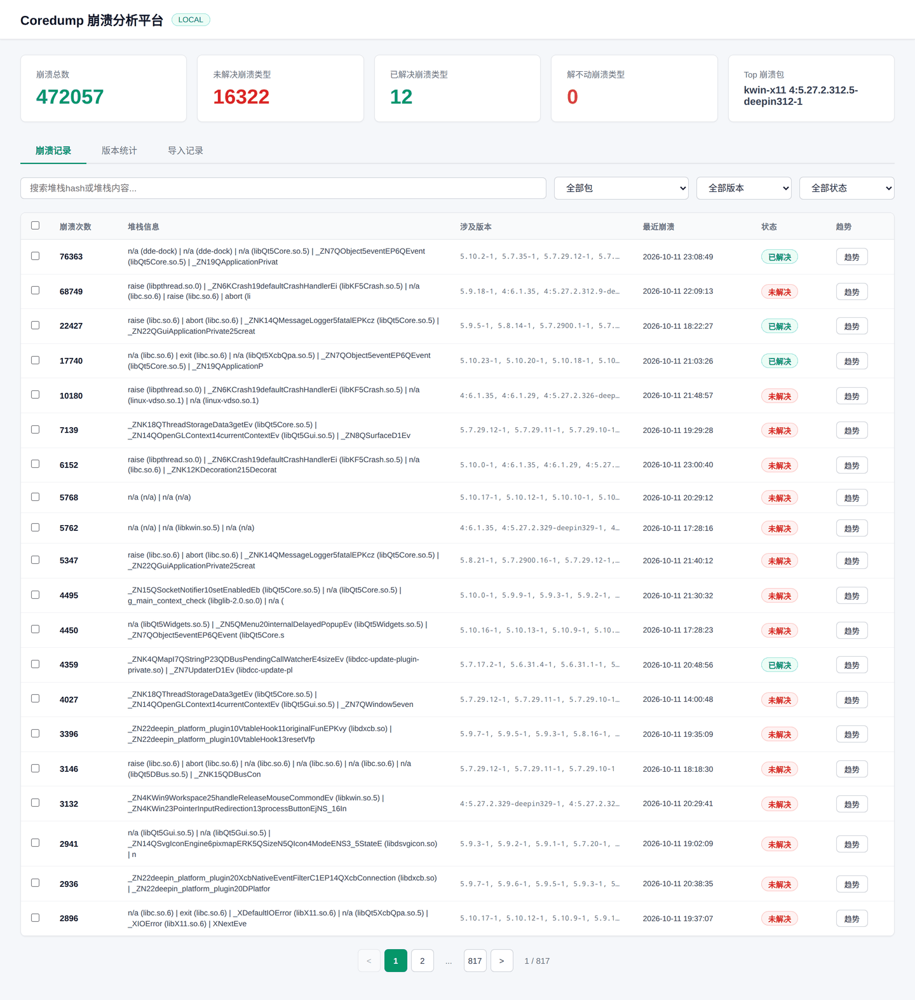
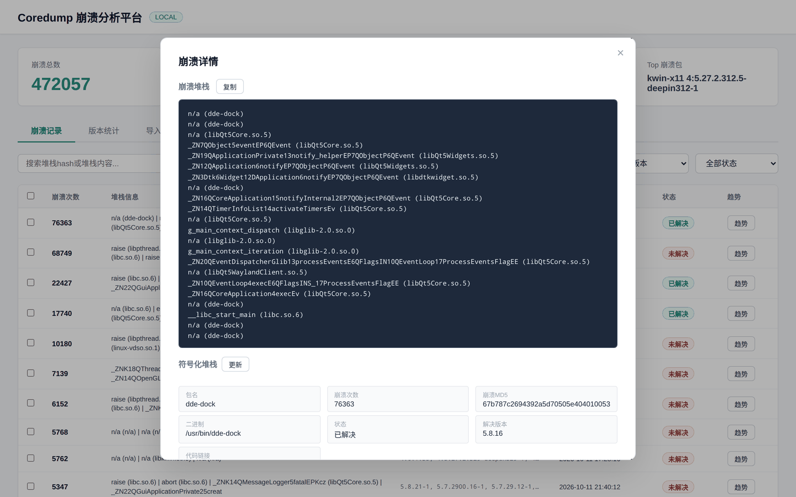
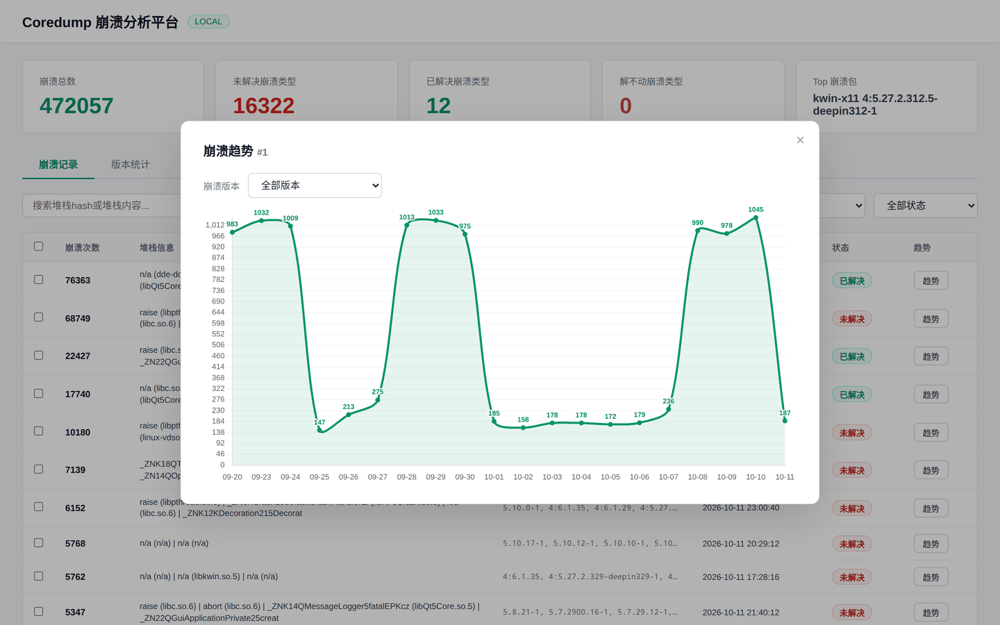
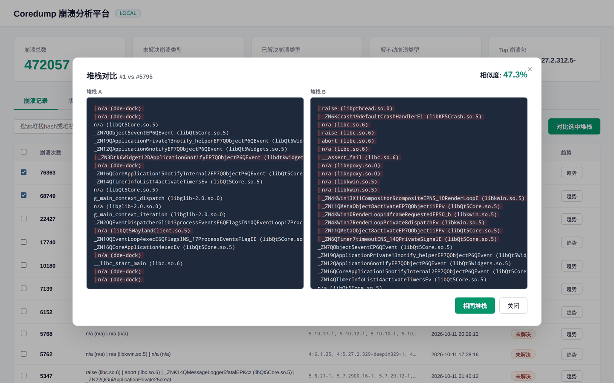
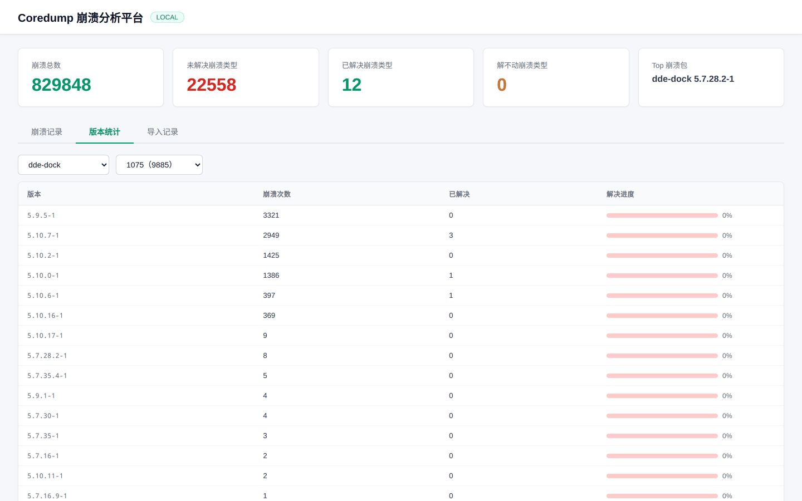
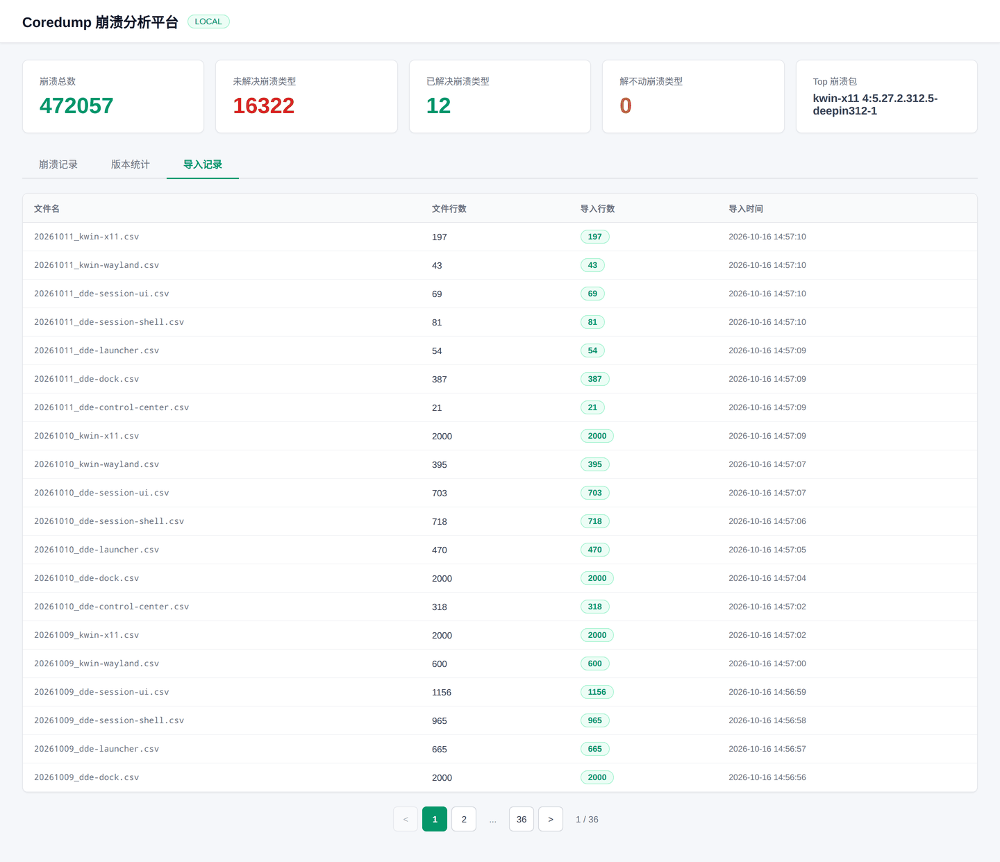

# coredump 崩溃分析平台

统信 UOS 桌面环境（kwin、dde-dock、dde-launcher 等）崩溃数据的采集、去重与定位分析工具。
从 Metabase 拉取 systemd-coredump 上报的崩溃记录，按清理过的调用栈指纹聚合成「崩溃聚合项」，
在 Web 界面上做检索、符号化还原、合并去重、状态流转和按版本的趋势统计。

## 功能

- **数据采集**：`crawl_data.py` 按天/按日期区间从 Metabase 导出各安装包的崩溃明细为 CSV
- **栈指纹聚合**：`import_csv.py` 剥掉 `#N 0xADDR +0xoffset` 等与地址相关的噪声后计算 MD5，
  地址变化不会把同一处崩溃拆成多条
- **符号化**：调用栈地址转函数名（`/api/stack/<pk>/symbolicate`），结果落库存库复用
- **Web 界面**：崩溃列表搜索/筛选、详情对比、栈合并、已解决/待处理/不修复状态流转、
  包与版本维度的趋势图、导入日志
- **自动导入**：`auto_import.py` 把 `crawled_data/*.csv` 增量入库并在 `imported_file` 表登记

## 界面预览

崩溃记录列表：概览卡片、按崩溃次数排序的聚合栈、包/版本/状态筛选与分页。



崩溃详情：原始堆栈 + 符号化堆栈、崩溃次数/MD5/二进制等元信息、再往下是解决状态与修复链接填写。



崩溃趋势：按天统计的 30 天走势，可切换版本过滤。



堆栈对比：勾选两条记录后进入，左右并排比对并给出相似度，判定同一处崩溃可直接合并。



版本统计：按版本看崩溃量与解决进度。



导入记录：每个 CSV 的行数、入库行数与导入时间，用于核对数据完整性。



> 截图取自真实运行实例，客户定制版本号后缀（如 `+xxx`、`_xxx`）在截图时已抹除。

## 目录结构

```
app.py              # Flask 应用与全部 API 路由
db_init.py          # 建库建表（package_info / crash_info / crash_stack / crash_hash /
                    #   symbol_info / binary_info / imported_file）
crawl_data.py       # 从 Metabase 拉取崩溃数据 -> crawled_data/*.csv
import_csv.py       # CSV 解析、栈清洗与入库
auto_import.py      # 待导入 CSV 的增量导入
templates/index.html# 单页前端（原生 JS + Chart.js）
static/js/          # Chart.js 静态资源
scripts/            # 辅助脚本
```

## 依赖

```bash
pip3 install -r requirements.txt
```

需要一个 MySQL/MariaDB 实例（默认 `localhost`，库名 `coredump_db`，由 `db_init.py` 自动创建）。

## 配置

所有连接信息通过环境变量提供，仓库内不保存任何凭据。把配置写到项目根目录的 `.env` 即可，
`db_init.py` 在导入时会自动读取（已 `export` 的变量优先，不会被覆盖），cron 里的
`python3 auto_import.py`、手动跑的 `python3 crawl_data.py` 都能直接生效，无需先 `source`：

```bash
cp .env.example .env      # 按实际情况填写，.env 已被 .gitignore 忽略
```

| 变量 | 说明 | 默认值 |
|---|---|---|
| `DB_HOST` / `DB_PORT` / `DB_USER` / `DB_PASSWORD` | MySQL 连接 | `localhost` / `3306` / `root` / 空 |
| `METABASE_BASE` | Metabase 站点地址 | 无（必填） |
| `METABASE_USER` / `METABASE_PASSWORD` | Metabase 登录账号 | 无（必填） |
| `METABASE_DATABASE_ID` | Metabase 中的数据库 ID | `10` |
| `METABASE_SOURCE_TABLE` | 崩溃明细表 ID | `196` |

## 使用

```bash
python3 db_init.py                     # 初始化数据库表
python3 crawl_data.py                  # 从最近导入日期的次日爬取到今天
python3 crawl_data.py 2026-08-01 2026-08-25   # 指定日期区间
python3 auto_import.py                 # 把 crawled_data 下的 CSV 增量入库
python3 app.py                         # 启动 Web 服务，默认 http://0.0.0.0:5000
```

## 数据说明

- `crawled_data/*.csv` 为抓取到的原始数据，含用户机器标识等运行环境信息，默认不纳入版本管理
- 栈指纹只保留「函数 + 文件:行号」层面的文本，地址与偏移在入库前被剥离，便于跨版本比对
- 未符号化的崩溃在界面上可一键触发符号化，成功后写回 `symbol_info` 缓存

## 常见问题

- **`ConnectionError: ('Connection aborted.', OSError(0, 'Error'))`**：系统代理把内网
  Metabase 地址也接管了。`crawl_data.py` 已用 `trust_env=False` 的 Session 直连，
  不受 `http_proxy`/`all_proxy` 影响；如果仍然连不上，用
  `curl --noproxy '*' -sS -o /dev/null -w '%{http_code}\n' $METABASE_BASE/api/health` 确认是不通还是地址写错。
- **`RuntimeError: 缺少 Metabase 凭据`**：项目根目录没有 `.env` 或其中的
  `METABASE_USER`/`METABASE_PASSWORD` 为空，按 `.env.example` 补齐即可。

## 许可

内部工具，未附带开源许可证。
